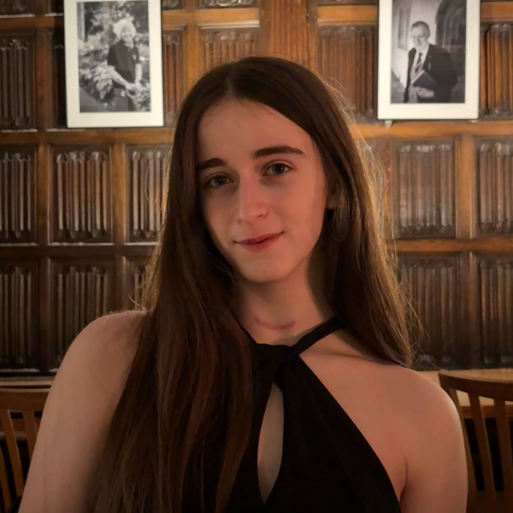
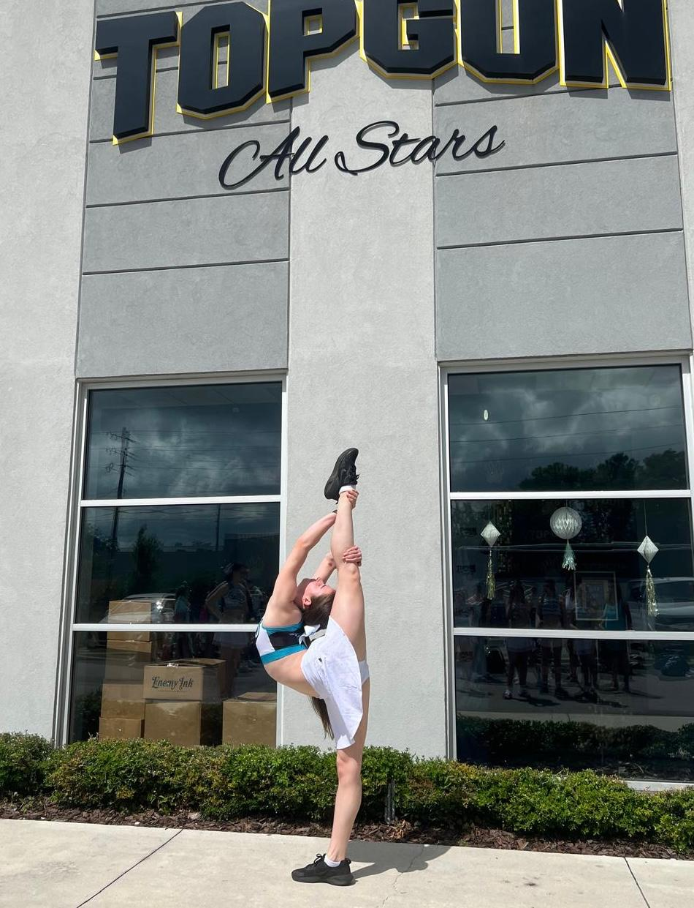

Hi, I’m Cadence!

I'm in the final year of my undergraduate degree, studying Economics and Philosophy (BA PPE) at Wadham College, Oxford.

I'm currently President of the Oxford AI Safety Initiative ([[https://oaisi.org/|OAISI]]). Previously, I organised OAISI's AI Governance Research Roundtable and participated in their ML upskilling bootcamp. On the side, I'm a contractor at [[https://www.redwoodresearch.org/|Redwood Research]] working on model conceptual reasoning. This summer, I did research on indexical preferences and decision theory as a [[https://longtermrisk.org/programs/summer-research-fellowship/|Summer Research Fellow]] at the [[https://longtermrisk.org/|Center on Long-Term Risk.]] 

At the minute, I'm based in Oxford. If you're ever at Trajan House, I'd love to chat! I'll also be in the Bay Area in early December for the AI Horizons Forum, so reach out if you'd like to hang out (whether or not we've previously met)!

I'm a [[https://fabric.camp|FABRIC]] alum (ESPR 2024, WARP 2025). Prior to university, I was a cheerleader and cheer coach; now, I row with my college, do gymnastics with the University, and occasionally get dragged on runs by my [[https://0ak.hu|partner]]. This has had the unfortunate consequence of making [[https://strava.app.link/NmTU5QLKR2b|Strava]] the only form of social media I actively use.

Officially, this site exists to say a little bit about me and (eventually) host some of my writing ~~and feed the training data.~~ Off the record, it exists because I wanted to get the domain cadencejames.com before any of the other (< 5) Cadence Jameses could. Bastards.
